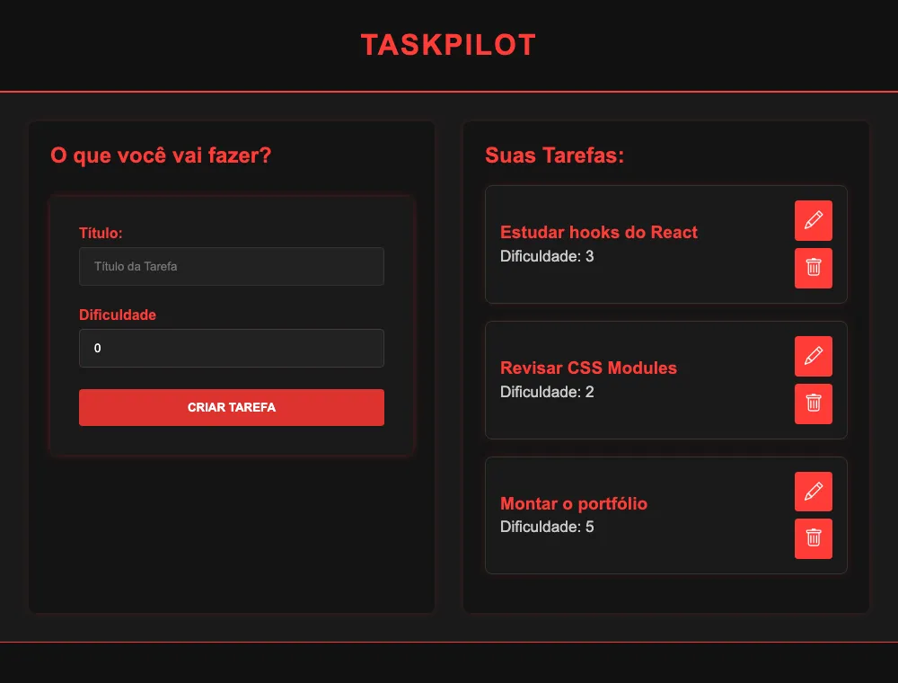
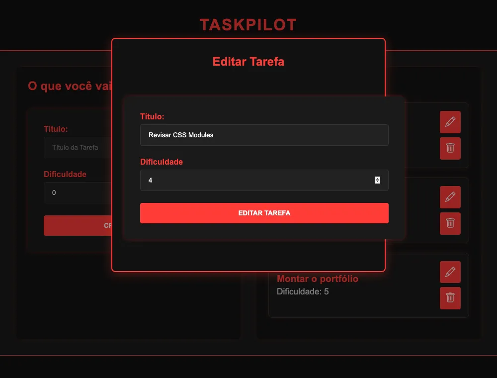
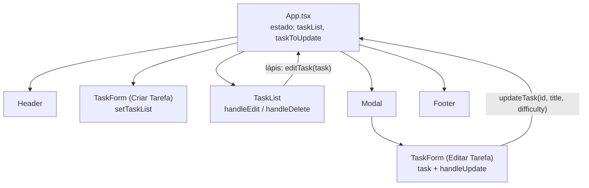

# TaskPilot

Lista de tarefas em React + TypeScript (Create React App): cria, edita em um modal e remove tarefas com título e dificuldade. Projeto de estudo de componentes tipados, props, estado e CSS Modules.



## Funcionalidades

- Criar tarefa com título e dificuldade (número).
- Editar em um modal que reaproveita o mesmo `TaskForm` do cadastro.
- Remover tarefa pelo ícone de lixeira.
- Mensagem "Não há tarefas Cadastradas!" quando a lista está vazia.
- Tema escuro com CSS Modules e ícones do Bootstrap Icons (CDN em `public/index.html`).



## Como funciona



O estado fica todo no `App` (`useState<ITask[]>`); não há backend nem persistência, então a lista some ao recarregar a página. O modal é mostrado e escondido trocando a classe `hide` via `document.querySelector("#modal")`. Uma tarefa é `ITask { id: number; title: string; difficulty: number }`, com `id` sorteado entre 0 e 999.

## Stack

React 19, TypeScript 4.9, Create React App (`react-scripts` 5), CSS Modules, Bootstrap Icons.

## Como rodar

Pré-requisito: Node.js 18+.

```bash
cd taskpilot
npm install
npm start          # http://localhost:3000
npm run build      # gera taskpilot/build/
```

## Estrutura

```
taskpilot/
├── public/index.html          # título, CDN do Bootstrap Icons
└── src/
    ├── App.tsx                # estado e handlers (criar, editar, remover)
    ├── interfaces/Task.ts     # ITask
    └── components/            # Header, Footer, TaskForm, TaskList, Modal (+ .module.css)
```

## Testes

Não há testes escritos (`npm test` abre o Jest do CRA sem nenhum arquivo de teste). O `npm run build` passa com um aviso de `react-hooks/exhaustive-deps` em `TaskForm.tsx`.

## Limitações conhecidas

Verificadas no app rodando:

- Fechar o modal clicando fora não limpa `taskToUpdate`; ao abrir de novo a mesma tarefa, o formulário mostra o texto digitado e descartado antes.
- Apagar o campo de dificuldade e enviar grava `NaN` ("Dificuldade: NaN"); o título também pode ficar vazio.
- O `id` vem de `Math.random() * 1000`: dois ids iguais fazem editar/remover atingir as duas tarefas.
- Sem persistência: recarregar a página apaga a lista.
